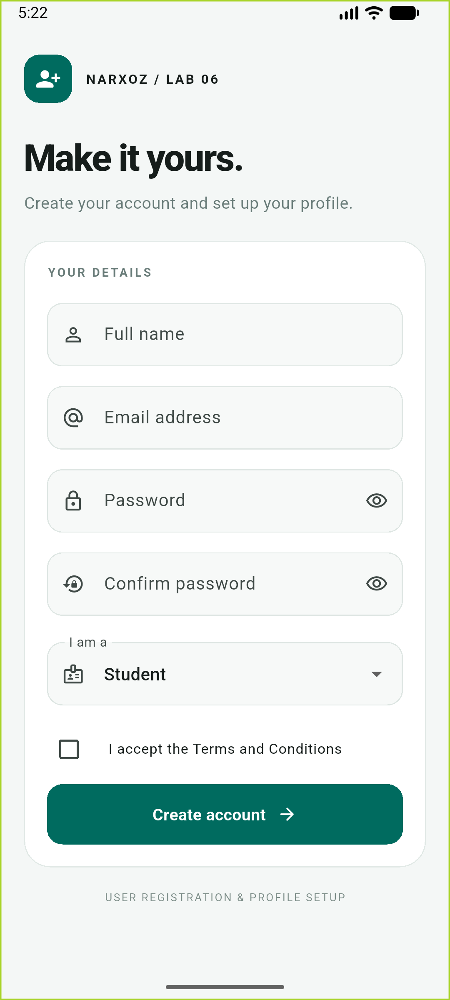

# Lab 6 - User Registration & Profile Setup

Flutter homework using Form, TextFormField, GlobalKey<FormState>, TextEditingController,
Checkbox, DropdownButtonFormField, and SnackBar.

## Run

```sh
flutter pub get
flutter run
```

Select a running Android emulator. Android and iOS projects are included;
building iOS requires macOS and Xcode.

## Features

- Full name is required; whitespace-only names are rejected.
- Email requires a local part, @, and a dotted domain (e.g. name@narxoz.kz).
- Password is required and must have at least 6 characters.
- Confirmation must match exactly, including case and whitespace.
- Both password fields are obscured and have visibility toggles.
- Edited fields validate in real time; password changes also recheck confirmation.
- Select Student, Teacher, or Developer.
- Terms and Conditions must be accepted; inline errors explain invalid input.
- Create account validates all fields using GlobalKey<FormState>.validate().
- Success prints profile data in the debug terminal and shows a SnackBar.
  Passwords are redacted in logs.
- Scrollable layout supports the keyboard and smaller screens.

This is a local educational demo; it does not create server accounts or store passwords.

## Verification

```sh
flutter analyze
flutter test
flutter build apk --debug
```

Tests cover empty submission, live validation, dependent confirmation,
mandatory terms, success feedback, obscured passwords, and all roles.

Validation follows the [official Flutter form guide](https://docs.flutter.dev/cookbook/forms/validation).
## Android preview


